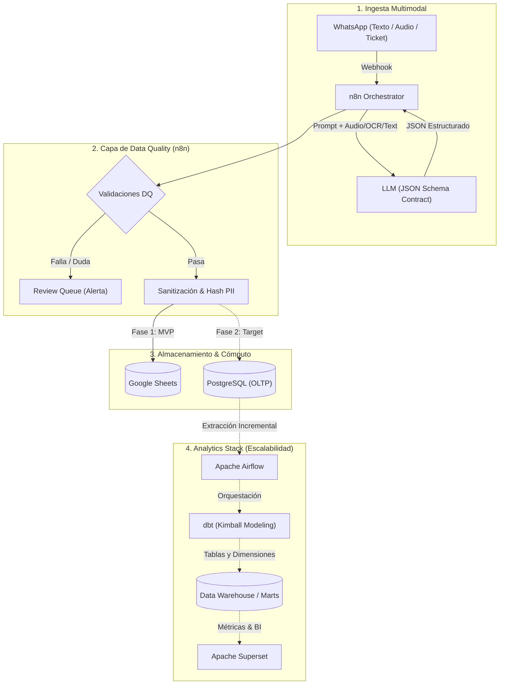

# 📱 WhatsApp Expense Bot & Analytics Platform

[]()
[]()
[]()
[]()

Sistema inteligente de captura y análisis de gastos personales y corporativos vía WhatsApp. Permite a los usuarios registrar gastos enviando **mensajes de texto, notas de voz o fotos de tickets/facturas**, extrayendo información estructurada mediante un LLM y centralizándola para analítica financiera.

---

## 🎯 Visión General

El proyecto está diseñado bajo un enfoque evolutivo de ingeniería de datos:
1. **Fase MVP (Actual):** Ingesta y orquestación ágil con **n8n**, extracción estructurada con **LLM** (Structured Outputs), compuerta de **Data Quality** y almacenamiento temporal en **Google Sheets**.
2. **Fase Analítica (Target):** Migración hacia **PostgreSQL** (OLTP), orquestación ELT con **Apache Airflow**, modelado dimensional (Kimball) con **dbt** y dashboards ejecutivos en **Apache Superset**.

---

## 🏗️ Arquitectura del Sistema



---

## 📂 Estructura del Repositorio

```bash
bot-wpp/
├── README.md
├── docker-compose.yml             # Despliegue local (n8n, Postgres, Airflow, Superset)
├── .env.example                   # Variables de entorno requeridas
├── docs/
│   ├── data_contract.json         # JSON Schema formal del LLM
│   ├── sheets_schema.md           # Diccionario de datos de Google Sheets
│   └── architecture_roadmap.md    # Especificación de migración a DWH
├── n8n/
│   ├── workflows/
│   │   └── whatsapp_expense_tracker.json  # Workflow exportado de n8n
│   └── scripts/
│       └── data_quality.js        # Lógica de validación y sanitización (Code Node)
├── dbt/
│   ├── dbt_project.yml
│   └── models/
│       ├── staging/               # stg_whatsapp__expenses.sql
│       ├── intermediate/          # int_expenses__currency_converted.sql
│       └── marts/                 # fct_expenses.sql, dim_categories.sql, dim_date.sql
└── airflow/
    └── dags/
        └── dag_whatsapp_financial_elt.py  # Orquestación con Cosmos + dbt
```

---

## 📋 Contrato de Datos (LLM Structured Output)

Para evitar alucinaciones, el LLM responde bajo un esquema estricto JSON:

```json
{
  "metadata": {
    "confidence_score": 0.95,
    "raw_text": "Cena de negocios en La Cabrera por 45.000 ARS pagado con tarjeta de crédito"
  },
  "transaction": {
    "transaction_date": "2026-10-19",
    "transaction_time": "21:15:00",
    "amount": 45000.00,
    "currency": "ARS",
    "category": "ALIMENTACION",
    "subcategory": "Restaurante",
    "merchant_name": "La Cabrera",
    "payment_method": "CREDIT_CARD",
    "description": "Cena de negocios"
  }
}
```

> Consulta el esquema formal en [`docs/data_contract.json`](docs/data_contract.json).

---

## 📊 Esquema del MVP en Google Sheets

Las columnas están nombradas en `snake_case` estricto y sin caracteres especiales para facilitar la carga directa a SQL sin transformaciones complejas:

| Columna | Tipo de Dato | Descripción / Regla |
| :--- | :--- | :--- |
| `transaction_id` | `UUID` | Identificador único generado en n8n (`$uuid`) |
| `message_id` | `VARCHAR` | ID de mensaje de WhatsApp (Garantía de idempotencia) |
| `user_phone_hash`| `CHAR(64)` | SHA-256 del número telefónico (Anonimización PII) |
| `input_type` | `VARCHAR` | `TEXT`, `AUDIO`, `IMAGE` |
| `transaction_date`| `DATE` | Fecha ISO (`YYYY-MM-DD`) |
| `transaction_time`| `TIME` | Hora (`HH:mm:ss`) o vacío |
| `amount` | `NUMERIC(12,2)` | Monto con punto decimal (ej: `150.50`) |
| `currency` | `CHAR(3)` | Código ISO 4217 (`USD`, `EUR`, `ARS`, `MXN`, etc.) |
| `category` | `VARCHAR` | Taxonomía fija (ej. `ALIMENTACION`, `TRANSPORTE`) |
| `subcategory` | `VARCHAR` | Clasificación detallada |
| `merchant_name` | `VARCHAR` | Nombre del comercio o proveedor |
| `payment_method` | `VARCHAR` | `CASH`, `CREDIT_CARD`, `DEBIT_CARD`, `TRANSFER` |
| `description` | `TEXT` | Detalle o concepto del gasto |
| `confidence_score`| `NUMERIC(3,2)` | Puntuación de certeza de la extracción (0.00 - 1.00) |
| `raw_text` | `TEXT` | Texto original / Transcripción para auditoría |
| `ingested_at_utc` | `TIMESTAMP` | Timestamp de registro en UTC (`ISO 8601`) |

---

## 🛡️ Reglas de Calidad de Datos (Data Quality en n8n)

Antes de persistir en Sheets, el Code Node ejecuta:
1. **Deduplicación e Idempotencia:** Valida `message_id` para evitar registrar duplicados por reintentos de red de WhatsApp.
2. **Sanitización Numérica:** Reemplaza comas por puntos, valida `amount > 0` y redondea a 2 decimales.
3. **Protección contra Inyección de Fórmulas:** Si un campo de texto inicia con `=`, `+`, `-` o `@`, se antepone `'` para prevenir ejecución maliciosa en hojas de cálculo.
4. **Validación de Monedas y Fechas:** Valida códigos de moneda contra catálogo ISO 4217 y fuerza fechas a formato ISO.
5. **Dead Letter Queue (DLQ):** Si `confidence_score < 0.65` o falta el monto, el registro se desvía a una hoja de revisión y se alerta al usuario.

---

## 🚀 Puesta en Marcha (MVP Quickstart)

### Prerrequisitos
- Cuenta de **n8n** (Cloud o Self-hosted vía Docker).
- Clave de API de LLM (OpenAI, Anthropic o Google Gemini).
- Acceso a WhatsApp Business API o servicio compatible (ej. Twilio, Meta Cloud API, Z-API o Evolution API).
- Cuenta de Servicio de Google Cloud (GCP) con permisos sobre **Google Sheets API**.

### Pasos de Instalación
1. **Clonar el repositorio:**
   ```bash
   git clone https://github.com/tu-usuario/bot-wpp.git
   cd bot-wpp
   ```
2. **Configurar variables de entorno:**
   ```bash
   cp .env.example .env
   # Completar credenciales de APIs, tokens y IDs de hoja
   ```
3. **Importar Workflow en n8n:**
   * Abre tu panel de n8n.
   * Ve a **Workflows > Import from File** y selecciona `n8n/workflows/whatsapp_expense_tracker.json`.
   * Vincula las credenciales de WhatsApp, Google Sheets y el proveedor LLM.
4. **Preparar Google Sheets:**
   * Crea una hoja de cálculo con la fila de encabezados indicada en [Esquema del MVP](#-esquema-del-mvp-en-google-sheets).
   * Comparte la hoja con el correo de la cuenta de servicio de GCP con rol de **Editor**.
5. **Activar el Webhook:**
   * Configura la URL del webhook de n8n en tu proveedor de WhatsApp.
   * Envía un mensaje de prueba: *"Gasté 15 USD en almuerzo con débito"*.

---

## 📈 Roadmap de Escalabilidad (Analytics Stack)

| Fase | Componente | Objetivo | Estado |
| :--- | :--- | :--- | :---: |
| **Fase 1** | n8n + Sheets | MVP funcional, validación con usuarios reales | 🟢 Activo |
| **Fase 2** | PostgreSQL | Reemplazo de Sheets por base de datos transaccional ACID | 🟡 Planeado |
| **Fase 3** | Apache Airflow + dbt | Carga incremental y modelado dimensional (Kimball) | ⚪ Backlog |
| **Fase 4** | Apache Superset | Dashboards analíticos, métricas financieras y KPIs | ⚪ Backlog |

---

## 👥 Contribución y Buenas Prácticas

1. Todos los cambios en prompts de extracción deben mantener compatibilidad con `docs/data_contract.json`.
2. No modifiques nombres de columnas en Google Sheets sin actualizar el mapeo en `n8n/scripts/data_quality.js`.
3. Para sugerencias de nuevas categorías o métricas, abre un *Issue* describiendo la justificación analítica.

---

## 📄 Licencia

Este proyecto está bajo la Licencia [MIT](LICENSE).
