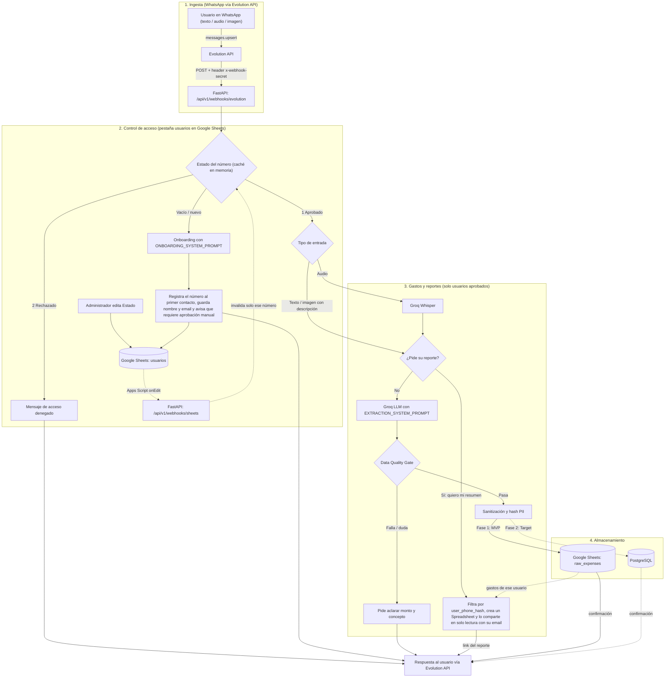
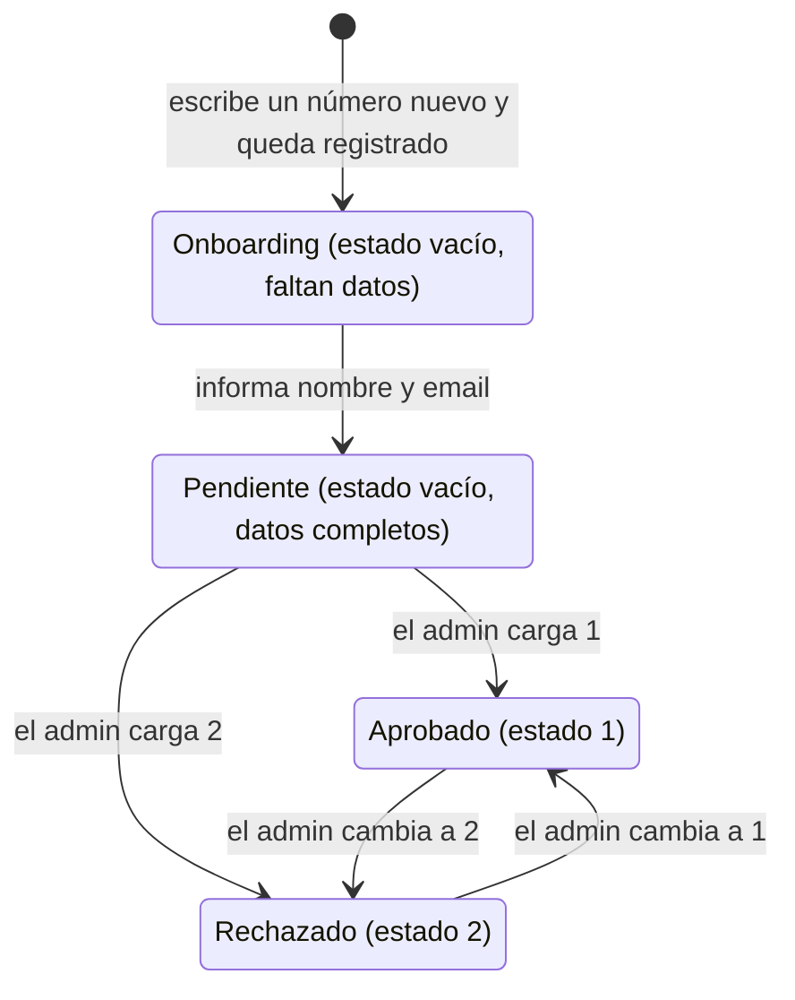

# 📱 WhatsApp Expense Bot & Analytics Platform

[]()
[]()
[]()
[]()

Sistema inteligente de captura y análisis de gastos personales y corporativos vía WhatsApp. Los usuarios aprobados registran gastos enviando **mensajes de texto, notas de voz o fotos de tickets con una descripción** (la lectura automática de la imagen, OCR, todavía no está implementada); un LLM extrae la información estructurada y la centraliza para analítica financiera.

---

## 🎯 Visión General

El proyecto está diseñado bajo un enfoque evolutivo de ingeniería de datos:
1. **Fase MVP (Actual):** servicio **FastAPI** que recibe los mensajes por **Evolution API**, controla el acceso de cada número con una pestaña de **Google Sheets** (aprobado, rechazado u onboarding), transcribe los audios con **Groq Whisper**, extrae los datos con un **LLM en Groq** (JSON estricto), los valida con una compuerta de **Data Quality** y los guarda en **Google Sheets** (o en PostgreSQL con `STORAGE_BACKEND=postgres`).
2. **Fase Analítica (Target):** migración hacia **PostgreSQL** (OLTP), orquestación ELT con **Apache Airflow**, modelado dimensional (Kimball) con **dbt** y dashboards ejecutivos en **Apache Superset**.

---

## 🏗️ Arquitectura del Sistema



**Detalles del flujo**
- **Webhook:** Evolution envía `messages.upsert` a FastAPI con el header `x-webhook-secret`; el servicio responde `200` de inmediato y procesa en segundo plano. Se ignoran los mensajes propios (`fromMe`), los grupos, los demás eventos y las otras instancias.
- **Acceso estricto:** si no se puede verificar el estado de un número, no se registra nada.
- **"Escribiendo…":** mientras Groq transcribe o procesa, el bot envía la presencia `composing` por Evolution y la corta justo antes de responder.
- **Concurrencia:** se procesa un mensaje a la vez por número y se descartan las reentregas del webhook (mismo `message_id`).
- **Audio:** se toma del base64 inline del webhook; si falta o viene corrupto, se descarga desde Evolution (`getBase64FromMediaMessage`) y se transcribe con Whisper.
- **Aprobaciones en tiempo real:** un Apps Script en la hoja avisa a `/api/v1/webhooks/sheets` cuando se edita `Estado` y el bot olvida solo ese número ([guía](docs/apps_script_usuarios.md)). Si no se puede releer, falla cerrado.
- **Reportes por demanda:** "quiero mi resumen" (texto o audio) no se registra como gasto: se genera un Spreadsheet con **solo los gastos de ese usuario** (filtro estricto por `user_phone_hash`) y se comparte en solo lectura con el email del onboarding.

---

## 📂 Estructura del Repositorio

```bash
bot-wpp/
├── README.md
├── docker-compose.yml             # App (FastAPI) + PostgreSQL
├── .env.example                   # Variables de entorno (placeholders)
├── pyproject.toml / requirements.txt
├── docker/                        # Dockerfile y entrypoint
├── config/credentials/            # JSON de la cuenta de servicio de Google (ignorado por git)
├── apps_script/
│   └── usuarios_onedit.gs         # Disparador de Google Apps Script (aprobaciones en tiempo real)
├── docs/
│   ├── data_contract.json         # JSON Schema formal del LLM
│   ├── sheets_schema.md           # Diccionario de datos de Google Sheets (gastos, usuarios y reportes)
│   ├── apps_script_usuarios.md    # Instalación del Apps Script
│   ├── instructivo_docker.md      # Guía punta a punta con Docker
│   └── instructivo_local.md       # Guía punta a punta en entorno local
├── scripts/
│   ├── setup_evolution_webhook.py # Apunta el webhook de Evolution API a este servicio
│   ├── check_groq.py              # Diagnóstico de los modelos disponibles en Groq
│   └── test_sheets_write.py       # Prueba de escritura en la hoja de gastos
├── src/
│   ├── main.py                    # Aplicación FastAPI
│   ├── api/v1/                    # webhooks.py (Evolution y Sheets), health.py, dependencies.py
│   ├── core/                      # Configuración, logging, excepciones y helpers de teléfono/async
│   ├── domain/                    # Enums y modelos Pydantic
│   ├── services/
│   │   ├── message_router.py      # Ruteo por estado del número (1 / 2 / vacío)
│   │   ├── onboarding_service.py  # Alta de usuarios desconocidos
│   │   ├── expense_service.py     # Registro de gastos (uno o varios por mensaje) y correcciones
│   │   ├── report_intent.py       # Detección de pedidos de reporte
│   │   ├── edit_intent.py         # Detección determinista de correcciones y de la opción elegida
│   │   ├── batch_selection.py     # Lista numerada pendiente cuando un lote tiene varios gastos
│   │   ├── report_service.py      # Reporte por demanda (aislado por usuario)
│   │   └── data_quality.py        # Data Quality Gate (validación por gasto)
│   └── infrastructure/
│       ├── whatsapp/              # Cliente y parser de Evolution API
│       ├── llm/                   # Cliente de Groq y prompts (onboarding / extracción / corrección)
│       ├── audio/                 # Transcripción con Groq Whisper
│       ├── cache/                 # Caché TTL en memoria
│       └── storage/               # Repositorios: Sheets (gastos, usuarios, reportes) y PostgreSQL
└── tests/                         # Unitarios y flujo end-to-end (sin red ni credenciales reales)
```

---

## 🔐 Control de Acceso y Onboarding

Cada número que escribe se valida contra la pestaña `usuarios` de Google Sheets **antes** de procesar nada. La columna `Estado` la edita únicamente el administrador:

| `Estado` | Comportamiento |
| :---: | :--- |
| `1` Aprobado | Registro de gastos: texto, audio (Groq Whisper) o imagen con descripción. Usa `EXTRACTION_SYSTEM_PROMPT`. |
| `2` Rechazado | Mensaje estándar de acceso denegado; no se procesa nada. |
| vacío / número nuevo | Onboarding (nombre y email, solo por texto) con `ONBOARDING_SYSTEM_PROMPT`. Se avisa que la cuenta requiere aprobación manual del administrador antes de poder registrar gastos. |

Cualquier otro valor en `Estado` se trata como vacío: nunca otorga acceso.



- **Caché en memoria:** la lista de usuarios se lee de la hoja una vez cada `USER_CACHE_TTL_SECONDS` (60 s por defecto) y sirve a todos los mensajes, para no agotar la cuota de lectura de la API de Sheets.
- **Aprobaciones en tiempo real (opcional):** con el [Apps Script](docs/apps_script_usuarios.md) instalado, aprobar o rechazar se aplica al instante y podés subir el TTL (por ejemplo a `3600`) para casi no leer la hoja. Sin él, el cambio tarda hasta el TTL en aplicarse.
- **Prompts aislados:** el onboarding y la extracción de gastos usan prompts y ejemplos separados ([prompts.py](src/infrastructure/llm/prompts.py)); un usuario sin aprobar nunca llega al prompt de extracción.
- **Un solo worker:** el control de duplicados, los locks por usuario y la caché viven en la memoria del proceso, así que ejecutá **un solo worker** de uvicorn (como hace el `Dockerfile`).
- **Esquema de la pestaña:** [docs/sheets_schema.md](docs/sheets_schema.md#pestaña-usuarios-control-de-acceso).

---

## 📋 Contrato de Datos (LLM Structured Output)

Para evitar alucinaciones, el LLM responde bajo un esquema estricto JSON. Este contrato aplica a la extracción de gastos (usuarios aprobados):

```json
{
  "metadata": {
    "confidence_score": 0.95,
    "raw_text": "Anotá 20.000 de pochoclos y, a la salida, pagué 5.000 de estacionamiento"
  },
  "transactions": [
    {
      "transaction_date": "2026-10-19",
      "transaction_time": null,
      "amount": 20000.00,
      "currency": "ARS",
      "category": "Entretenimiento",
      "subcategory": "Cine",
      "merchant_name": null,
      "payment_method": "Tarjeta de Débito",
      "description": "Pochoclos"
    },
    {
      "transaction_date": "2026-10-19",
      "transaction_time": null,
      "amount": 5000.00,
      "currency": "ARS",
      "category": "Transporte",
      "subcategory": "Estacionamiento",
      "merchant_name": null,
      "payment_method": "Tarjeta de Débito",
      "description": "Estacionamiento"
    }
  ]
}
```

> Consultá el esquema formal en [`docs/data_contract.json`](docs/data_contract.json). El contrato devuelve siempre una lista `transactions` (un elemento por gasto, máximo `MAX_TRANSACTIONS_PER_MESSAGE`) y sigue aceptando la clave antigua `transaction` con un solo gasto.

La taxonomía es **estrictamente en español** y `payment_method` es obligatorio:
- **Categorías:** `Alimentación`, `Transporte`, `Vivienda`, `Servicios`, `Salud`, `Entretenimiento`, `Educación`, `Compras`, `Otros`.
- **Medios de pago:** `Efectivo`, `Tarjeta de Crédito`, `Tarjeta de Débito`, `Transferencia`, `Billetera Virtual`, `No Especificado` (si el usuario no menciona cómo pagó).

Se toleran diferencias de mayúsculas y tildes (`ALIMENTACION` → `Alimentación`), pero un valor fuera de la taxonomía se rechaza. Los enums, el prompt y el contrato JSON se mantienen sincronizados con un test.

El onboarding tiene su propio contrato, definido en `ONBOARDING_SYSTEM_PROMPT`: `{"collected": {"full_name", "email"}, "reply"}`. El LLM solo extrae datos y redacta la próxima pregunta; el aviso final de aprobación manual es texto fijo.

---

## 🧾 Gastos Múltiples en un Solo Mensaje

Un texto o una nota de voz puede describir varios gastos. El LLM devuelve una lista y el bot registra **una fila por gasto**, con una única confirmación numerada:

```text
Usuario: Anotá 20.000 de pochoclos y, a la salida, pagué 5.000 de estacionamiento con débito.
Bot:     ✅ Se registraron 2 gastos:

         1. Entretenimiento (Cine) — 20,000.00 ARS · Pochoclos
         2. Transporte (Estacionamiento) — 5,000.00 ARS

         📅 2026-10-29 · 💳 Tarjeta de Débito
```

- **Trazabilidad:** cada fila usa el `message_id` original con un sufijo (`<message_id>-0`, `<message_id>-1`, …). Un mensaje con un solo gasto conserva el `message_id` sin sufijo.
- **Escritura atómica:** las filas del lote se escriben en **una sola llamada** (`append_rows` en Sheets, un `INSERT` en Postgres): o se guardan todas o ninguna.
- **Ítems inválidos:** si un gasto del lote no pasa el Data Quality Gate, se guardan los demás y la respuesta detalla cuáles no y por qué.
- **Corrección dentro de un lote:** al citar una confirmación con varios gastos el bot pide cuál corregir y acepta `el 2 eran 6000` (o directamente `el 2 eran 6000` citando la confirmación, en un solo paso).

---

## 🛡️ Degradación Controlada (fallas de servicios externos)

Ninguna falla queda en silencio: si algo externo se cae, el usuario recibe un mensaje claro que dice si su gasto se guardó o no.

| Situación | Mensaje al usuario |
| :--- | :--- |
| Groq (LLM) responde con error | ⚠️ Ocurrió un error en el servidor de inteligencia artificial. Tu gasto **no fue guardado**. Intentá de nuevo en unos minutos. |
| Groq tarda más de `GROQ_TIMEOUT_SECONDS` | ⚠️ El servidor de inteligencia artificial **tardó demasiado**. Tu gasto no fue guardado. |
| Sheets/Postgres falla al escribir | ⚠️ No pude guardar tu registro en la base de datos. **No se guardó nada**. Conservá el ticket o intentá en un rato. |
| La base no responde a tiempo | ⚠️ La base de datos **no respondió a tiempo**: puede que no se haya guardado. Verificá con "quiero mi resumen". |
| Whisper no puede transcribir | ⚠️ No pudimos procesar el audio. **No se registró nada**: reenvialo o escribilo. |
| Excepción no prevista | ⚠️ Ocurrió un error inesperado… (log con contexto, sin datos sensibles) |

Todas las llamadas bloqueantes (Groq, Whisper, repositorio) corren en un hilo con un **tiempo máximo** ([`run_blocking`](src/core/async_utils.py)), y los SDK se configuran con timeouts explícitos: por defecto el cliente de Groq espera 600 s, que dejaría al usuario sin respuesta.

---

## ✏️ Edición y Corrección de Registros

Un usuario aprobado corrige un gasto **respondiendo (citando) el mensaje de confirmación del bot**. No se crea una fila nueva: se actualiza la existente.

```text
Usuario: Gasté 1500 en café.
Bot:     ✅ Gasto Registrado… (respuesta citada al mensaje del usuario)

Usuario: (cita el mensaje del bot) Me equivoqué, eran 15000.
Bot:     ✏️ Registro modificado · Monto: 15,000.00 ARS (antes 1,500.00 ARS) …
```

- **Detección:** Evolution manda el ID citado en `contextInfo.stanzaId`, **al nivel de `data`** (hermano de `message`); WhatsApp en crudo lo anida dentro del contenido. El parser revisa ambos lugares, lo expone como `quoted_message_id` y el bot entra en modo edición.
- **Resolución de la fila:** se busca por `message_id` **o** `reply_message_id` (el ID de la confirmación del bot, que se guarda al responder) y **siempre** con el `user_phone_hash` del remitente: una cita a un gasto ajeno no se encuentra.
- **Corrección:** el LLM recibe el registro actual + el mensaje del usuario (`EDIT_SYSTEM_PROMPT`) y devuelve el contrato JSON completo cambiando **solo** los campos corregidos. La validación es la misma del alta (Data Quality Gate).
- **Persistencia:** se sobrescriben únicamente las columnas de datos. `message_id` (idempotencia), `timestamp` (ingesta) y `user_phone_hash` quedan intactos.
- **Cita no reconocida:** el bot pide que aclare y **no** registra nada, para no ensuciar la base con filas inventadas.
- **Corrección dentro de un lote:** si la confirmación citada corresponde a varios gastos, el bot muestra la lista numerada y acepta `el 2 eran 6000` (o el mismo texto al citar, en un solo paso).
- **Corrección sin cita:** si el usuario escribe *"me equivoqué, eran 155"* sin responder a un mensaje, el bot lo detecta (regla determinista, sin LLM), **no registra nada** y le pide que cite la confirmación. Antes ese mensaje terminaba en un error técnico de validación.
- **Solo cambia lo que el usuario menciona:** si la corrección no dice la moneda ni la fecha, se conservan las del registro (un *"eran 155"* sobre un gasto de 15 USD queda en 155 USD, nunca pasa a ARS por el valor por defecto).
- **Última confirmación:** se recuerda solo el ID de la última respuesta del bot para cada gasto, así que las correcciones en cadena se hacen citando esa.
- **Sin límite de antigüedad:** se puede corregir cualquier gasto propio. No hay historial de versiones (el "antes → después" queda en el mensaje de WhatsApp).

---

## 📊 Esquema de Datos

### Google Sheets (MVP)

**Pestaña `raw_expenses`** (si está vacía, el bot crea los encabezados; si tiene otra estructura, hay que reemplazarla por esta):

| Columna | Descripción | Ejemplo |
| :--- | :--- | :--- |
| `timestamp` | Fecha y hora de ingesta, en la zona horaria `TIMEZONE` (`YYYY-MM-DD HH:mm:ss`) | `2026-10-19 22:50:00` |
| `message_id` | ID único del mensaje de Evolution API: llave de idempotencia (sobrevive a reinicios). En un lote se sufija `-0`, `-1`, … | `3EB0A1B2C3D4E5F60001` |
| `user_phone_hash` | SHA-256 del número del remitente: vincula cada gasto con su dueño sin exponer el teléfono | `9f86d081884c7d65...` |
| `fecha_gasto` | Fecha real del gasto resuelta por el LLM (por ejemplo, "ayer") | `2026-10-18` |
| `monto` | Valor numérico con punto decimal | `4500.00` |
| `moneda` | Código ISO 4217 | `ARS`, `USD` |
| `categoria` | Taxonomía fija en español (ver arriba) | `Alimentación` |
| `subcategoria` | Detalle granular extraído por el LLM | `Supermercado` |
| `medio_de_pago` | Medio de pago en español (ver arriba) | `Tarjeta de Débito` |
| `descripcion` | Detalle del gasto | `Almuerzo de trabajo` |
| `reply_message_id` | **Opcional.** ID de la confirmación que envió el bot: permite corregir el gasto respondiendo a ese mensaje | `3EB0A1B2C3D4E5F60009` |

**Pestaña `usuarios`** (`Telefono`, `Nombre`, `Email`, `Estado`, `Fecha_Registro`): control de acceso, documentada junto con la anterior en [docs/sheets_schema.md](docs/sheets_schema.md#pestaña-usuarios-control-de-acceso).

### PostgreSQL (`STORAGE_BACKEND=postgres`)

Tabla `raw_whatsapp.expenses`, definida en [postgres_repo.py](src/infrastructure/storage/postgres_repo.py):

| Columna | Tipo | Descripción / Regla |
| :--- | :--- | :--- |
| `transaction_id` | `UUID` (PK) | Identificador único generado por el servicio |
| `message_id` | `VARCHAR(128)` único | ID del mensaje de WhatsApp (garantía de idempotencia) |
| `user_phone_hash` | `VARCHAR(64)` | SHA-256 del número telefónico (anonimización PII) |
| `input_type` | `VARCHAR(20)` | `TEXT`, `AUDIO`, `IMAGE` |
| `transaction_date` | `DATE` | Fecha ISO del gasto (`YYYY-MM-DD`) |
| `transaction_time` | `TIME` (nulo) | Hora (`HH:mm:ss`) o vacío |
| `amount` | `FLOAT` | Monto con punto decimal, redondeado a 2 decimales |
| `currency` | `VARCHAR(3)` | Código ISO 4217 |
| `category` | `VARCHAR(50)` | Taxonomía fija en español (ver arriba) |
| `subcategory` | `VARCHAR(50)` (nulo) | Clasificación detallada |
| `merchant_name` | `VARCHAR(100)` (nulo) | Nombre del comercio o proveedor |
| `payment_method` | `VARCHAR(30)` | Medio de pago en español (ver arriba) |
| `description` | `TEXT` | Detalle o concepto del gasto |
| `confidence_score` | `FLOAT` | Puntuación de certeza de la extracción (0.00 - 1.00) |
| `raw_text` | `TEXT` | Texto original / transcripción para auditoría |
| `reply_message_id` | `VARCHAR(128)` (nulo) | ID de la confirmación del bot, para corregir el gasto citándola |

> El esquema `raw_whatsapp` y la tabla `expenses` todavía no se crean automáticamente (no hay migraciones): creálos antes de usar `STORAGE_BACKEND=postgres`. Si la tabla ya existía sin la función de edición, agregá la columna con `ALTER TABLE raw_whatsapp.expenses ADD COLUMN reply_message_id VARCHAR(128);`.

---

## 🛡️ Reglas de Calidad de Datos

Antes de persistir un gasto se aplican estas reglas. Las de los puntos 3 a 8 viven en [`DataQualityGate`](src/services/data_quality.py):
1. **Acceso previo:** solo se procesan los mensajes de usuarios aprobados (estado `1`).
2. **Idempotencia:** se descartan las reentregas del webhook (mismo `message_id`) y se valida que el mensaje no haya sido registrado ya: en Sheets contra la columna `message_id` (se lee una vez al arrancar, así que sobrevive a reinicios) y en PostgreSQL con una restricción única.
3. **Confianza mínima:** si `confidence_score < 0.65`, el gasto no se guarda y se le pide al usuario que reenvíe el mensaje aclarando monto y concepto.
4. **Monto:** debe ser mayor a 0 y se redondea a 2 decimales.
5. **Moneda y fecha:** la moneda debe tener formato ISO 4217 (3 letras mayúsculas) y, si el usuario no menciona otra, se asume `ARS`. Una fecha futura genera una advertencia, no un rechazo.
6. **Protección contra inyección de fórmulas:** si un campo de texto inicia con `=`, `+`, `-` o `@`, se antepone `'` para prevenir ejecución maliciosa en hojas de cálculo. El mismo tratamiento se aplica a los datos de onboarding.
7. **Privacidad (PII):** el número telefónico se persiste hasheado (SHA-256) en `user_phone_hash` y los logs lo enmascaran. Los reportes filtran **solo** por ese hash.
8. **Taxonomía en español:** la categoría y el medio de pago deben pertenecer a las listas de arriba; `payment_method` es obligatorio.
9. **Uno o varios gastos:** la validación es por gasto, así que un ítem inválido de un lote no bloquea a los demás; el bot informa exactamente qué se guardó y qué no. Un mensaje con más de `MAX_TRANSACTIONS_PER_MESSAGE` gastos se rechaza pidiendo dividirlo.

---

## 🚀 Puesta en Marcha (MVP Quickstart)

### Prerrequisitos
- **Python 3.11+** (o Docker).
- **API key de Groq** (LLM y Whisper).
- Una instancia de **Evolution API v2** con un número de WhatsApp vinculado por QR.
- Cuenta de Servicio de Google Cloud (GCP) con la **Google Sheets API** y la **Google Drive API** habilitadas.
- Que Evolution pueda llamar al bot. Si corren en tu misma máquina no hace falta nada más (`localhost` o `host.docker.internal`); si Evolution está en otro servidor, necesitás una URL pública (o un túnel como ngrok).

> 📘 **Guías detalladas, punta a punta y verificadas:** [instructivo Docker](docs/instructivo_docker.md) (bot y Evolution en contenedores) e [instructivo local](docs/instructivo_local.md) (bot con uvicorn; Evolution en Docker o nativo). Los pasos de abajo son el resumen.

### Pasos de Instalación
1. **Clonar el repositorio:**
   ```bash
   git clone https://github.com/tu-usuario/bot-wpp.git
   cd bot-wpp
   ```
2. **Configurar variables de entorno:**
   ```bash
   cp .env.example .env
   # Completar credenciales y IDs (ver la tabla de abajo)
   ```

   | Variable | Obligatoria | Descripción |
   | :--- | :---: | :--- |
   | `GROQ_API_KEY` | ✅ | API key de Groq. |
   | `EVOLUTION_API_URL` | ✅ | URL base de Evolution API (si ambos corren en Docker, el nombre del servicio, por ejemplo `http://evolution_api:8080`). |
   | `EVOLUTION_API_KEY` | ✅ | API key de Evolution (global o de la instancia). |
   | `EVOLUTION_INSTANCE` | ✅ | Nombre de la instancia vinculada por QR. |
   | `EVOLUTION_WEBHOOK_SECRET` | ✅ | Secreto compartido que Evolution envía en `x-webhook-secret`. Sin él, el bot rechaza todas las llamadas. |
   | `SPREADSHEET_ID` | ✅ | ID (o URL) del spreadsheet de Google. |
   | `WORKSHEET_NAME` | | Pestaña de gastos (por defecto `raw_expenses`). |
   | `USERS_WORKSHEET_NAME` | | Pestaña de usuarios (por defecto `usuarios`). |
   | `USER_CACHE_TTL_SECONDS` | | Segundos que se cachea la lista de usuarios (por defecto `60`; con el Apps Script instalado podés subirlo a `3600`). |
   | `SHEETS_WEBHOOK_SECRET` | | Secreto del Apps Script de aprobaciones en tiempo real. Sin él, `/api/v1/webhooks/sheets` rechaza todo. |
   | `REPORTS_FOLDER_ID` | | Carpeta de Drive (compartida con los administradores) donde se crean los reportes. Si falta, quedan en el Drive de la cuenta de servicio. |
   | `REPORT_COOLDOWN_SECONDS` | | Segundos mínimos entre dos reportes del mismo usuario (por defecto `300`). |
   | `GOOGLE_APPLICATION_CREDENTIALS` / `GCP_SERVICE_ACCOUNT_B64` | | Credenciales de la cuenta de servicio, si el `.json` no está en `config/credentials/` (donde se detecta solo). |
   | `STORAGE_BACKEND` | | `sheets` (por defecto) o `postgres`. |
   | `POSTGRES_*` | | Conexión a PostgreSQL, solo con `STORAGE_BACKEND=postgres`. |
   | `TIMEZONE` | | Zona horaria de los timestamps (por defecto `America/Argentina/Buenos_Aires`). |

3. **Preparar Google Sheets:**
   * Compartí el spreadsheet con el correo de la cuenta de servicio de GCP con rol de **Editor**, y habilitá la **Google Drive API** en su proyecto (para los reportes).
   * Creá la pestaña `raw_expenses` (los 10 encabezados se crean solos si está vacía; si ya tiene otra estructura, reemplazala por la de [docs/sheets_schema.md](docs/sheets_schema.md#pestaña-raw_expenses-registro-de-gastos)).
   * Creá la pestaña `usuarios` con los encabezados de [docs/sheets_schema.md](docs/sheets_schema.md#pestaña-usuarios-control-de-acceso). Si no existe, el bot no puede verificar a nadie y rechaza todos los mensajes.
4. **Levantar el servicio:**
   ```bash
   # Local
   python -m venv venv && source venv/bin/activate
   pip install -r requirements.txt
   uvicorn src.main:app --reload

   # o con Docker (app en el puerto 8000 + PostgreSQL)
   docker compose up --build
   ```
   Verificá que responda en `http://localhost:8000/api/v1/health` (la documentación interactiva está en `/docs`).
5. **Conectar Evolution API:** apuntá el webhook de la instancia al bot (solo el evento `MESSAGES_UPSERT`, con el audio inline en base64):
   ```bash
   python scripts/setup_evolution_webhook.py --url https://<tu-dominio>/api/v1/webhooks/evolution
   ```
6. **Probar:** agregá tu número a la pestaña `usuarios` con `estado` = `1` (o escribile al bot desde un número nuevo y aprobalo después) y enviá un mensaje: *"Gasté 15 USD en almuerzo con débito"*.

### Tests y diagnóstico
```bash
pytest                              # unitarios y flujo end-to-end, sin red ni credenciales reales
python scripts/check_groq.py        # lista los modelos de Groq disponibles y prueba una inferencia
python scripts/test_sheets_write.py # escribe una fila de prueba en la hoja de gastos
```

---

## 📈 Roadmap de Escalabilidad (Analytics Stack)

| Fase | Componente | Objetivo | Estado |
| :--- | :--- | :--- | :---: |
| **Fase 1** | FastAPI + Evolution API + Groq + Sheets | MVP funcional con control de acceso y onboarding, validación con usuarios reales | 🟢 Activo |
| **Fase 2** | PostgreSQL | Reemplazo de Sheets por base de datos transaccional ACID (el repositorio ya existe; falta crear el esquema y migrar) | 🟡 Planeado |
| **Fase 3** | Apache Airflow + dbt | Carga incremental y modelado dimensional (Kimball) | ⚪ Backlog |
| **Fase 4** | Apache Superset | Dashboards analíticos, métricas financieras y KPIs | ⚪ Backlog |

---

## 👥 Contribución y Buenas Prácticas

1. Todos los cambios en prompts de extracción deben mantener compatibilidad con [`docs/data_contract.json`](docs/data_contract.json).
2. Los prompts de onboarding (`ONBOARDING_*`), de extracción (`EXTRACTION_*`) y de corrección (`EDIT_*`) están aislados en [prompts.py](src/infrastructure/llm/prompts.py): no mezcles ejemplos entre ramas.
3. No modifiques los nombres de columnas de las hojas sin actualizar el mapeo en el código: `EXPENSE_SHEET_HEADERS` y `ExpenseRecord.to_sheets_dict()` en [models.py](src/domain/models.py) (gastos) y `HEADERS` en [sheets_users_repo.py](src/infrastructure/storage/sheets_users_repo.py) (usuarios), además de [docs/sheets_schema.md](docs/sheets_schema.md) y del [Apps Script](apps_script/usuarios_onedit.gs).
4. Para sugerencias de nuevas categorías o métricas, abrí un *Issue* describiendo la justificación analítica. Una categoría nueva también debe agregarse a `CategoryEnum`, al prompt de extracción y a `docs/data_contract.json` (un test verifica que los tres coincidan).
5. Corré `pytest` antes de integrar cambios y usá siempre datos ficticios (números, nombres y emails) en tests, ejemplos y documentación.

---

## 📄 Licencia

Este proyecto está bajo la Licencia [MIT](LICENSE).
