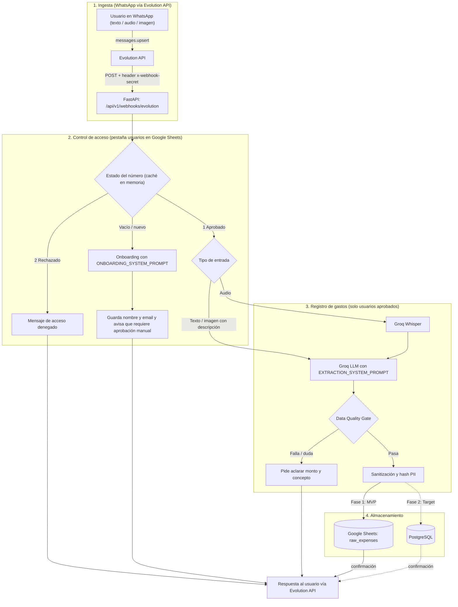
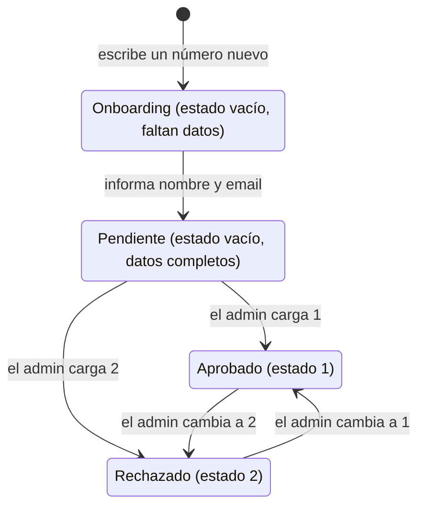

# 📱 WhatsApp Expense Bot & Analytics Platform

[]()
[]()
[]()
[]()

Sistema inteligente de captura y análisis de gastos personales y corporativos vía WhatsApp. Los usuarios aprobados registran gastos enviando **mensajes de texto, notas de voz o fotos de tickets con una descripción** (la lectura automática de la imagen, OCR, todavía no está implementada); un LLM extrae la información estructurada y la centraliza para analítica financiera.

---

## 🎯 Visión General

El proyecto está diseñado bajo un enfoque evolutivo de ingeniería de datos:
1. **Fase MVP (Actual):** servicio **FastAPI** que recibe los mensajes por **Evolution API**, controla el acceso de cada número con una pestaña de **Google Sheets** (aprobado, rechazado u onboarding), transcribe los audios con **Groq Whisper**, extrae los datos con un **LLM en Groq** (JSON estricto), los valida con una compuerta de **Data Quality** y los guarda en **Google Sheets** (o en PostgreSQL con `STORAGE_BACKEND=postgres`).
2. **Fase Analítica (Target):** migración hacia **PostgreSQL** (OLTP), orquestación ELT con **Apache Airflow**, modelado dimensional (Kimball) con **dbt** y dashboards ejecutivos en **Apache Superset**.

---

## 🏗️ Arquitectura del Sistema



**Detalles del flujo**
- **Webhook:** Evolution envía `messages.upsert` a FastAPI con el header `x-webhook-secret`; el servicio responde `200` de inmediato y procesa en segundo plano. Se ignoran los mensajes propios (`fromMe`), los grupos, los demás eventos y las otras instancias.
- **Acceso estricto:** si no se puede verificar el estado de un número, no se registra nada.
- **"Escribiendo…":** mientras Groq transcribe o procesa, el bot envía la presencia `composing` por Evolution y la corta justo antes de responder.
- **Concurrencia:** se procesa un mensaje a la vez por número y se descartan las reentregas del webhook (mismo `message_id`).
- **Audio:** se toma del base64 inline del webhook; si falta o viene corrupto, se descarga desde Evolution (`getBase64FromMediaMessage`) y se transcribe con Whisper.

---

## 📂 Estructura del Repositorio

```bash
bot-wpp/
├── README.md
├── docker-compose.yml             # App (FastAPI) + PostgreSQL
├── .env.example                   # Variables de entorno (placeholders)
├── pyproject.toml / requirements.txt
├── docker/                        # Dockerfile y entrypoint
├── config/credentials/            # JSON de la cuenta de servicio de Google (ignorado por git)
├── docs/
│   ├── data_contract.json         # JSON Schema formal del LLM
│   └── sheets_schema.md           # Diccionario de datos de Google Sheets (gastos y usuarios)
├── scripts/
│   ├── setup_evolution_webhook.py # Apunta el webhook de Evolution API a este servicio
│   ├── check_groq.py              # Diagnóstico de los modelos disponibles en Groq
│   └── test_sheets_write.py       # Prueba de escritura en la hoja de gastos
├── src/
│   ├── main.py                    # Aplicación FastAPI
│   ├── api/v1/                    # webhooks.py (Evolution), health.py, dependencies.py
│   ├── core/                      # Configuración, logging, excepciones y helpers de teléfono
│   ├── domain/                    # Enums y modelos Pydantic
│   ├── services/
│   │   ├── message_router.py      # Ruteo por estado del número (1 / 2 / vacío)
│   │   ├── onboarding_service.py  # Alta de usuarios desconocidos
│   │   ├── expense_service.py     # Registro de gastos (usuarios aprobados)
│   │   └── data_quality.py        # Data Quality Gate
│   └── infrastructure/
│       ├── whatsapp/              # Cliente y parser de Evolution API
│       ├── llm/                   # Cliente de Groq y prompts (onboarding / extracción)
│       ├── audio/                 # Transcripción con Groq Whisper
│       ├── cache/                 # Caché TTL en memoria
│       └── storage/               # Repositorios: Sheets (gastos y usuarios) y PostgreSQL
└── tests/                         # Unitarios y flujo end-to-end (sin red ni credenciales reales)
```

---

## 🔐 Control de Acceso y Onboarding

Cada número que escribe se valida contra la pestaña `usuarios` de Google Sheets **antes** de procesar nada. La columna `estado` la edita únicamente el administrador:

| `estado` | Comportamiento |
| :---: | :--- |
| `1` Aprobado | Registro de gastos: texto, audio (Groq Whisper) o imagen con descripción. Usa `EXTRACTION_SYSTEM_PROMPT`. |
| `2` Rechazado | Mensaje estándar de acceso denegado; no se procesa nada. |
| vacío / número nuevo | Onboarding (nombre y email, solo por texto) con `ONBOARDING_SYSTEM_PROMPT`. Se avisa que la cuenta requiere aprobación manual del administrador antes de poder registrar gastos. |

Cualquier otro valor en `estado` se trata como vacío: nunca otorga acceso.



- **Caché en memoria:** la lista de usuarios se lee de la hoja una vez cada `USER_CACHE_TTL_SECONDS` (60 s por defecto) y sirve a todos los mensajes, para no agotar la cuota de lectura de la API de Sheets. Aprobar o rechazar a alguien tarda hasta ese tiempo en aplicarse.
- **Prompts aislados:** el onboarding y la extracción de gastos usan prompts y ejemplos separados ([prompts.py](src/infrastructure/llm/prompts.py)); un usuario sin aprobar nunca llega al prompt de extracción.
- **Un solo worker:** el control de duplicados, los locks por usuario y la caché viven en la memoria del proceso, así que ejecutá **un solo worker** de uvicorn (como hace el `Dockerfile`).
- **Esquema de la pestaña:** [docs/sheets_schema.md](docs/sheets_schema.md#pestaña-usuarios-control-de-acceso).

---

## 📋 Contrato de Datos (LLM Structured Output)

Para evitar alucinaciones, el LLM responde bajo un esquema estricto JSON. Este contrato aplica a la extracción de gastos (usuarios aprobados):

```json
{
  "metadata": {
    "confidence_score": 0.95,
    "raw_text": "Cena de negocios en La Cabrera por 45.000 ARS pagado con tarjeta de crédito"
  },
  "transaction": {
    "transaction_date": "2026-10-19",
    "transaction_time": "21:15:00",
    "amount": 45000.00,
    "currency": "ARS",
    "category": "ALIMENTACION",
    "subcategory": "Restaurante",
    "merchant_name": "La Cabrera",
    "payment_method": "CREDIT_CARD",
    "description": "Cena de negocios"
  }
}
```

> Consultá el esquema formal en [`docs/data_contract.json`](docs/data_contract.json).

El onboarding tiene su propio contrato, definido en `ONBOARDING_SYSTEM_PROMPT`: `{"collected": {"full_name", "email"}, "reply"}`. El LLM solo extrae datos y redacta la próxima pregunta; el aviso final de aprobación manual es texto fijo.

---

## 📊 Esquema de Datos

### Google Sheets (MVP)

**Pestaña `raw_expenses`** (si está vacía, el bot crea los encabezados):

| Columna | Descripción | Ejemplo |
| :--- | :--- | :--- |
| `timestamp` | Fecha y hora de ingesta, en la zona horaria `TIMEZONE` (`YYYY-MM-DD HH:mm:ss`) | `2026-10-19 22:50:00` |
| `fecha_gasto` | Fecha real del gasto resuelta por el LLM (por ejemplo, "ayer") | `2026-10-18` |
| `monto` | Valor numérico con punto decimal | `4500.00` |
| `moneda` | Código ISO 4217 | `ARS`, `USD` |
| `categoria` | Taxonomía fija: `ALIMENTACION`, `TRANSPORTE`, `VIVIENDA`, `SERVICIOS`, `SALUD`, `ENTRETENIMIENTO`, `EDUCACION`, `COMPRAS`, `OTROS` | `ALIMENTACION` |
| `descripcion` | Detalle del gasto | `Almuerzo de trabajo` |

> La hoja de gastos no guarda quién registró cada gasto. El registro completo, con `user_phone_hash`, solo se persiste en PostgreSQL.

**Pestaña `usuarios`:** control de acceso, documentada en [docs/sheets_schema.md](docs/sheets_schema.md#pestaña-usuarios-control-de-acceso).

### PostgreSQL (`STORAGE_BACKEND=postgres`)

Tabla `raw_whatsapp.expenses`, definida en [postgres_repo.py](src/infrastructure/storage/postgres_repo.py):

| Columna | Tipo | Descripción / Regla |
| :--- | :--- | :--- |
| `transaction_id` | `UUID` (PK) | Identificador único generado por el servicio |
| `message_id` | `VARCHAR(128)` único | ID del mensaje de WhatsApp (garantía de idempotencia) |
| `user_phone_hash` | `VARCHAR(64)` | SHA-256 del número telefónico (anonimización PII) |
| `input_type` | `VARCHAR(20)` | `TEXT`, `AUDIO`, `IMAGE` |
| `transaction_date` | `DATE` | Fecha ISO del gasto (`YYYY-MM-DD`) |
| `transaction_time` | `TIME` (nulo) | Hora (`HH:mm:ss`) o vacío |
| `amount` | `FLOAT` | Monto con punto decimal, redondeado a 2 decimales |
| `currency` | `VARCHAR(3)` | Código ISO 4217 |
| `category` | `VARCHAR(50)` | Taxonomía fija (ver arriba) |
| `subcategory` | `VARCHAR(50)` (nulo) | Clasificación detallada |
| `merchant_name` | `VARCHAR(100)` (nulo) | Nombre del comercio o proveedor |
| `payment_method` | `VARCHAR(30)` | `CASH`, `CREDIT_CARD`, `DEBIT_CARD`, `BANK_TRANSFER`, `CRYPTO`, `OTHER`, `UNKNOWN` |
| `description` | `TEXT` | Detalle o concepto del gasto |
| `confidence_score` | `FLOAT` | Puntuación de certeza de la extracción (0.00 - 1.00) |
| `raw_text` | `TEXT` | Texto original / transcripción para auditoría |

> El esquema `raw_whatsapp` y la tabla `expenses` todavía no se crean automáticamente (no hay migraciones): creálos antes de usar `STORAGE_BACKEND=postgres`.

---

## 🛡️ Reglas de Calidad de Datos

Antes de persistir un gasto se aplican estas reglas. Las de los puntos 3 a 7 viven en [`DataQualityGate`](src/services/data_quality.py):
1. **Acceso previo:** solo se procesan los mensajes de usuarios aprobados (estado `1`).
2. **Idempotencia:** se descartan las reentregas del webhook (mismo `message_id`) y se valida que el mensaje no haya sido registrado ya (en memoria para Sheets, restricción única en PostgreSQL).
3. **Confianza mínima:** si `confidence_score < 0.65`, el gasto no se guarda y se le pide al usuario que reenvíe el mensaje aclarando monto y concepto.
4. **Monto:** debe ser mayor a 0 y se redondea a 2 decimales.
5. **Moneda y fecha:** la moneda debe tener formato ISO 4217 (3 letras mayúsculas) y, si el usuario no menciona otra, se asume `ARS`. Una fecha futura genera una advertencia, no un rechazo.
6. **Protección contra inyección de fórmulas:** si un campo de texto inicia con `=`, `+`, `-` o `@`, se antepone `'` para prevenir ejecución maliciosa en hojas de cálculo. El mismo tratamiento se aplica a los datos de onboarding.
7. **Privacidad (PII):** el número telefónico se persiste hasheado (SHA-256) y los logs lo enmascaran.

---

## 🚀 Puesta en Marcha (MVP Quickstart)

### Prerrequisitos
- **Python 3.11+** (o Docker).
- **API key de Groq** (LLM y Whisper).
- Una instancia de **Evolution API v2** con un número de WhatsApp vinculado por QR.
- Cuenta de Servicio de Google Cloud (GCP) con la **Google Sheets API** habilitada.
- Una URL a la que Evolution pueda llamar (en desarrollo, un túnel como ngrok).

### Pasos de Instalación
1. **Clonar el repositorio:**
   ```bash
   git clone https://github.com/tu-usuario/bot-wpp.git
   cd bot-wpp
   ```
2. **Configurar variables de entorno:**
   ```bash
   cp .env.example .env
   # Completar credenciales y IDs (ver la tabla de abajo)
   ```

   | Variable | Obligatoria | Descripción |
   | :--- | :---: | :--- |
   | `GROQ_API_KEY` | ✅ | API key de Groq. |
   | `EVOLUTION_API_URL` | ✅ | URL base de Evolution API (si ambos corren en Docker, el nombre del servicio, por ejemplo `http://evolution_api:8080`). |
   | `EVOLUTION_API_KEY` | ✅ | API key de Evolution (global o de la instancia). |
   | `EVOLUTION_INSTANCE` | ✅ | Nombre de la instancia vinculada por QR. |
   | `EVOLUTION_WEBHOOK_SECRET` | ✅ | Secreto compartido que Evolution envía en `x-webhook-secret`. Sin él, el bot rechaza todas las llamadas. |
   | `SPREADSHEET_ID` | ✅ | ID (o URL) del spreadsheet de Google. |
   | `WORKSHEET_NAME` | | Pestaña de gastos (por defecto `raw_expenses`). |
   | `USERS_WORKSHEET_NAME` | | Pestaña de usuarios (por defecto `usuarios`). |
   | `USER_CACHE_TTL_SECONDS` | | Segundos que se cachea la lista de usuarios (por defecto `60`). |
   | `GOOGLE_APPLICATION_CREDENTIALS` / `GCP_SERVICE_ACCOUNT_B64` | | Credenciales de la cuenta de servicio, si el `.json` no está en `config/credentials/` (donde se detecta solo). |
   | `STORAGE_BACKEND` | | `sheets` (por defecto) o `postgres`. |
   | `POSTGRES_*` | | Conexión a PostgreSQL, solo con `STORAGE_BACKEND=postgres`. |
   | `TIMEZONE` | | Zona horaria de los timestamps (por defecto `America/Argentina/Buenos_Aires`). |

3. **Preparar Google Sheets:**
   * Compartí el spreadsheet con el correo de la cuenta de servicio de GCP con rol de **Editor**.
   * Creá la pestaña `raw_expenses` (los encabezados se crean solos si está vacía).
   * Creá la pestaña `usuarios` con los encabezados de [docs/sheets_schema.md](docs/sheets_schema.md#pestaña-usuarios-control-de-acceso). Si no existe, el bot no puede verificar a nadie y rechaza todos los mensajes.
4. **Levantar el servicio:**
   ```bash
   # Local
   python -m venv venv && source venv/bin/activate
   pip install -r requirements.txt
   uvicorn src.main:app --reload

   # o con Docker (app en el puerto 8000 + PostgreSQL)
   docker compose up --build
   ```
   Verificá que responda en `http://localhost:8000/api/v1/health` (la documentación interactiva está en `/docs`).
5. **Conectar Evolution API:** apuntá el webhook de la instancia al bot (solo el evento `MESSAGES_UPSERT`, con el audio inline en base64):
   ```bash
   python scripts/setup_evolution_webhook.py --url https://<tu-dominio>/api/v1/webhooks/evolution
   ```
6. **Probar:** agregá tu número a la pestaña `usuarios` con `estado` = `1` (o escribile al bot desde un número nuevo y aprobalo después) y enviá un mensaje: *"Gasté 15 USD en almuerzo con débito"*.

### Tests y diagnóstico
```bash
pytest                              # unitarios y flujo end-to-end, sin red ni credenciales reales
python scripts/check_groq.py        # lista los modelos de Groq disponibles y prueba una inferencia
python scripts/test_sheets_write.py # escribe una fila de prueba en la hoja de gastos
```

---

## 📈 Roadmap de Escalabilidad (Analytics Stack)

| Fase | Componente | Objetivo | Estado |
| :--- | :--- | :--- | :---: |
| **Fase 1** | FastAPI + Evolution API + Groq + Sheets | MVP funcional con control de acceso y onboarding, validación con usuarios reales | 🟢 Activo |
| **Fase 2** | PostgreSQL | Reemplazo de Sheets por base de datos transaccional ACID (el repositorio ya existe; falta crear el esquema y migrar) | 🟡 Planeado |
| **Fase 3** | Apache Airflow + dbt | Carga incremental y modelado dimensional (Kimball) | ⚪ Backlog |
| **Fase 4** | Apache Superset | Dashboards analíticos, métricas financieras y KPIs | ⚪ Backlog |

---

## 👥 Contribución y Buenas Prácticas

1. Todos los cambios en prompts de extracción deben mantener compatibilidad con [`docs/data_contract.json`](docs/data_contract.json).
2. Los prompts de onboarding (`ONBOARDING_*`) y de extracción (`EXTRACTION_*`) están aislados en [prompts.py](src/infrastructure/llm/prompts.py): no mezcles ejemplos entre ramas.
3. No modifiques los nombres de columnas de las hojas sin actualizar el mapeo en el código: `ExpenseRecord.to_sheets_row()` en [models.py](src/domain/models.py) (gastos) y `HEADERS` en [sheets_users_repo.py](src/infrastructure/storage/sheets_users_repo.py) (usuarios), además de [docs/sheets_schema.md](docs/sheets_schema.md).
4. Para sugerencias de nuevas categorías o métricas, abrí un *Issue* describiendo la justificación analítica. Una categoría nueva también debe agregarse a `CategoryEnum` y al prompt de extracción.
5. Corré `pytest` antes de integrar cambios y usá siempre datos ficticios (números, nombres y emails) en tests, ejemplos y documentación.

---

## 📄 Licencia

Este proyecto está bajo la Licencia [MIT](LICENSE).
