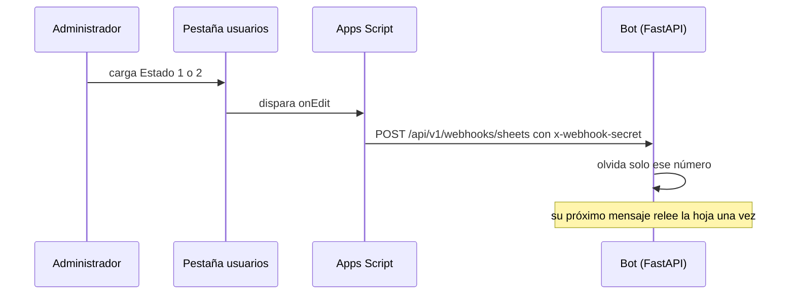

# ⚡ Apps Script: aprobaciones en tiempo real

Por defecto el bot guarda la lista de usuarios en memoria y la vuelve a leer cada `USER_CACHE_TTL_SECONDS` (60 s), así que aprobar o rechazar a alguien tarda hasta un minuto en aplicarse. Con este disparador de Google Apps Script el cambio es **inmediato** y, como el bot deja de depender del vencimiento de la caché, podés subir el TTL (por ejemplo a `3600`) y reducir casi a cero las lecturas a la API de Sheets.



El bot **no** deja de validar contra la hoja: el aviso solo le indica qué número cambió. Si un registro invalidado no se puede releer (por ejemplo, la API de Sheets falla), el bot **cierra el acceso** de esa persona en vez de usar el dato viejo: un rechazo recién cargado nunca se responde con el estado anterior.

## Requisitos

- El bot tiene que ser **alcanzable desde Internet por HTTPS**: Apps Script corre en los servidores de Google y no puede llamar a `localhost` ni a `host.docker.internal`. En desarrollo usá un túnel (por ejemplo `ngrok http 8000` o Cloudflare Tunnel) y copiá su URL pública.
- Ser editor del spreadsheet.

## Instalación

1. **Secreto en el bot.** Generá uno y agregalo al `.env` del bot (es distinto al de Evolution: así, si se filtra uno, no habilita al otro). Reiniciá o recreá el bot.
   ```bash
   python3 -c "import secrets; print(secrets.token_urlsafe(32))"
   ```
   ```
   SHEETS_WEBHOOK_SECRET=<el valor generado>
   ```
2. **Pegar el script.** En el spreadsheet: **Extensiones → Apps Script**, borrá el contenido por defecto y pegá [usuarios_onedit.gs](../apps_script/usuarios_onedit.gs).
3. **Propiedades del script** (⚙️ Configuración del proyecto → *Propiedades del script* → Agregar):

   | Propiedad | Valor |
   | :--- | :--- |
   | `BOT_WEBHOOK_URL` | `https://<tu-dominio-publico>/api/v1/webhooks/sheets` |
   | `WEBHOOK_SECRET` | el mismo valor de `SHEETS_WEBHOOK_SECRET` |

4. **Instalar el disparador.** En el editor elegí la función `instalarTrigger` y presioná **Ejecutar**. Google pide autorización (acceso a las hojas y a servicios externos): aceptala. Tiene que ser un disparador *instalable*: un `onEdit` simple no puede llamar a servicios externos.
5. **Probar.** Ejecutá `probarConexion`: el registro tiene que decir `Conexión OK`. Después cambiá el `Estado` de una fila y mirá el log del bot: `Users cache invalidated for 549****1234`.

También podés probar el endpoint a mano:

```bash
curl -s -X POST https://<tu-dominio-publico>/api/v1/webhooks/sheets \
  -H "x-webhook-secret: <SHEETS_WEBHOOK_SECRET>" -H "Content-Type: application/json" \
  -d '{"event":"ping"}'          # {"status":"PONG"}
```

## Qué avisa y qué no

| Cambio en la pestaña `usuarios` | Efecto |
| :--- | :--- |
| Editar `Estado` de una fila | Aviso inmediato de ese número |
| Pegar o arrastrar `Estado` en más de 20 filas | Un solo aviso "invalidar todo" |
| Editar `Nombre`, `Email` u otras columnas | Sin aviso (no afectan el acceso) |
| Borrar filas, o cambiar un `Telefono` | Sin aviso: se aplica al vencer el TTL, o ejecutá `invalidarTodo` |
| Editar otras pestañas | Se ignora |

## Seguridad y límites

- El secreto vive en las **propiedades del script**, nunca en el código. Quien pueda editar el spreadsheet puede abrir el script y verlo: limitá los editores y rotá el secreto (en el `.env` y en la propiedad) si alguien se va. Con el secreto solo se puede forzar al bot a releer la hoja; no se puede aprobar a nadie.
- El endpoint responde `401` con un secreto incorrecto y `503` si `SHEETS_WEBHOOK_SECRET` no está configurado (falla cerrado).
- El disparador se ejecuta con la cuenta de quien lo instaló; si esa persona pierde acceso a la hoja, hay que reinstalarlo. Apps Script limita las llamadas externas (20.000 por día en cuentas gratuitas), muy por encima del uso esperado.
- Si el bot no responde, el script reintenta 3 veces; el cambio igualmente se aplica al vencer el TTL.
