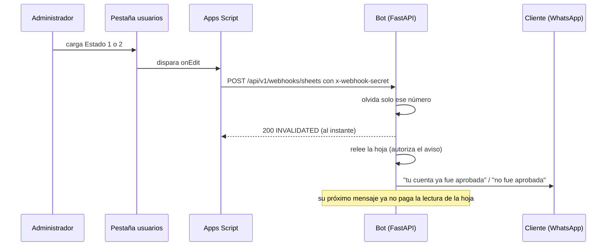

# ⚡ Apps Script: aprobaciones en tiempo real

Por defecto el bot guarda la lista de usuarios en memoria y la vuelve a leer cada `USER_CACHE_TTL_SECONDS` (60 s), así que aprobar o rechazar a alguien tarda hasta un minuto en aplicarse. Con este disparador de Google Apps Script el cambio es **inmediato** y, como el bot deja de depender del vencimiento de la caché, podés subir el TTL (`300` es un buen equilibrio; `3600` si el túnel es estable) y reducir casi a cero las lecturas a la API de Sheets.

Además, cuando el administrador edita `Estado`, **el bot le escribe al cliente por WhatsApp**: si quedó en `1`, le avisa que ya puede registrar gastos (con un ejemplo de uso); si quedó en `2`, que su solicitud no fue aprobada. Así nadie tiene que adivinar cuándo probar.



El bot **no** deja de validar contra la hoja: el aviso solo le indica qué número cambió. El estado que se anuncia sale **siempre de releer la hoja**, nunca del payload: con el secreto filtrado no se puede mandar un WhatsApp a un número cualquiera. Si un registro invalidado no se puede releer (por ejemplo, la API de Sheets falla), el bot **cierra el acceso** de esa persona en vez de usar el dato viejo, y no manda ningún aviso.

## Requisitos

- El bot tiene que ser **alcanzable desde Internet por HTTPS**: Apps Script corre en los servidores de Google y no puede llamar a `localhost` ni a `host.docker.internal`. En desarrollo usá un túnel (por ejemplo `ngrok http 8000` o Cloudflare Tunnel) y copiá su URL pública.
- Ser editor del spreadsheet.

## Instalación

1. **Secreto en el bot.** Generá uno y agregalo al `.env` del bot (es distinto al de Evolution: así, si se filtra uno, no habilita al otro). Reiniciá o recreá el bot.
   ```bash
   python3 -c "import secrets; print(secrets.token_urlsafe(32))"
   ```
   ```
   SHEETS_WEBHOOK_SECRET=<el valor generado>
   ```
2. **Pegar el script.** En el spreadsheet: **Extensiones → Apps Script**, borrá el contenido por defecto y pegá [usuarios_onedit.gs](../apps_script/usuarios_onedit.gs).
3. **Propiedades del script** (⚙️ Configuración del proyecto → *Propiedades del script* → Agregar):

   | Propiedad | Valor |
   | :--- | :--- |
   | `BOT_WEBHOOK_URL` | `https://<tu-dominio-publico>/api/v1/webhooks/sheets` |
   | `WEBHOOK_SECRET` | el mismo valor de `SHEETS_WEBHOOK_SECRET` |

4. **Instalar el disparador.** En el editor elegí la función `instalarTrigger` y presioná **Ejecutar**. Google pide autorización (acceso a las hojas y a servicios externos): aceptala. Tiene que ser un disparador *instalable*: un `onEdit` simple no puede llamar a servicios externos.
5. **Probar.** Ejecutá `probarConexion`: el registro tiene que decir `Conexión OK`. Después cambiá el `Estado` de una fila y mirá el log del bot: `Users cache invalidated for 549****1234` y `Access notice (approved) sent to 549****4455`.
6. **Avisar a los ya aprobados (una sola vez).** Ejecutá `reenviarAvisos`: recorre la pestaña y manda el aviso de todas las filas que ya están en `1` o `2` (el bot ignora las pendientes y no repite el aviso a quien lo recibió en la última hora).
7. **Activar aviso de fallos.** En **⏰ Activadores**, editá `onEditHandler` → *Configuración de notificaciones de fallos* → **Notificarme inmediatamente**. Es la forma de enterarte si el túnel cambia de URL o el bot deja de responder ([cuotas y costos](#cuotas-y-costos-google)).

También podés probar el endpoint a mano:

```bash
curl -s -X POST https://<tu-dominio-publico>/api/v1/webhooks/sheets \
  -H "x-webhook-secret: <SHEETS_WEBHOOK_SECRET>" -H "Content-Type: application/json" \
  -d '{"event":"ping"}'          # {"status":"PONG"}
```

## Qué avisa y qué no

| Cambio en la pestaña `usuarios` | Efecto |
| :--- | :--- |
| Editar `Estado` de una fila | Aviso inmediato de ese número + WhatsApp al cliente (`1` aprobado, `2` rechazado) |
| Pegar o arrastrar `Estado` en varias filas | Un POST por lote de 50 filas: se invalida todo una vez y se avisa a cada fila |
| Pegar `Estado` en más de 500 filas | Un solo aviso "invalidar todo" (sin WhatsApp: Apps Script no tiene tiempo para tanto) |
| Editar `Nombre`, `Email` u otras columnas | Sin aviso (no afectan el acceso) |
| Borrar filas, o cambiar un `Telefono` | Sin aviso: se aplica al vencer el TTL, o ejecutá `invalidarTodo` |
| Volver a guardar el mismo `Estado` | Sin aviso (para una sola celda se usa `e.oldValue`; en general, el bot no repite el mismo aviso dentro de una hora) |
| Dejar `Estado` vacío | Sin aviso (sigue pendiente) |
| Editar otras pestañas | Se ignora |

## Diagnóstico: ¿está funcionando el trigger?

Estos son los tres motivos por los que el disparador "parece no andar", en orden de frecuencia:

1. **`SHEETS_WEBHOOK_SECRET` vacío en el `.env` del bot.** El endpoint falla cerrado: toda llamada responde `503` y el script lo registra como `El bot respondió HTTP 503`. Setealo, poné el mismo valor en la propiedad `WEBHOOK_SECRET` y recreá el contenedor.
2. **El bot no es alcanzable desde Internet.** Apps Script corre en servidores de Google: `localhost`, `127.0.0.1` y `host.docker.internal` **no existen** desde ahí, y `http://` sin TLS tampoco sirve. Usá un túnel (`cloudflared tunnel --url http://localhost:8000` o `ngrok http 8000`) o un despliegue real, y poné esa URL en `BOT_WEBHOOK_URL`. Con un túnel gratuito la URL cambia en cada reinicio: hay que actualizar la propiedad y volver a probar.
3. **El TTL enmascara el resultado.** Con `USER_CACHE_TTL_SECONDS=60`, el cambio se aplica igual dentro del minuto aunque el trigger esté roto. La prueba de que el trigger funciona **no** es que el usuario pueda registrar gastos: es el log del bot (`Users cache invalidated for 549****1234`) y el mensaje de WhatsApp.

Otras causas silenciosas:

- La pestaña tiene que llamarse exactamente `usuarios` (minúsculas) y tener las columnas `Telefono` y `Estado`; si no, el script corta sin mandar nada (solo deja un `console.error`).
- Tiene que existir el disparador **instalable**: ejecutá `instalarTrigger` y confirmá en *Activadores* (`ScriptApp.getProjectTriggers()`) que figura `onEditHandler` → *Al editar*.
- `onEditHandler` no se puede probar con **Ejecutar** desde el editor: sin el objeto `e` vuelve enseguida sin hacer nada. Se prueba editando una celda.
- Si el aviso llega dos veces, o no llega, revisá que el bot no esté corriendo con más de un worker (la caché y el control de duplicados viven en memoria del proceso).

## Cuotas y costos (Google)

El circuito completo es **gratuito**: la API de Google Sheets y Apps Script se miden por cuota, no por facturación. La única pieza paga del sistema es Groq, y este camino no la usa (no hay ninguna llamada al LLM para aprobar o avisar).

**Costo de una edición de `Estado`:**

| Recurso | Costo |
| :--- | :--- |
| Lecturas de Sheets API | **1** por lote editado (no una por fila) |
| Escrituras de Sheets API | 0 |
| Ejecución de Apps Script | 1 ejecución de ~1-2 s + 1 lectura de cada propiedad del script |
| `UrlFetchApp` | 1 llamada por cada 50 filas (el script parte los lotes) |
| Mensajes de WhatsApp | 1 por usuario aprobado o rechazado |

**Límites y consumo esperado:**

| Recurso | Límite | Consumo esperado |
| :--- | :--- | :--- |
| Lecturas de Sheets API | 300/min por proyecto · 60/min por usuario · **sin tope diario** | 1 por edición + 1 cuando vence el TTL con tráfico |
| Escrituras de Sheets API | 300/min por proyecto | 1 por gasto guardado o alta de usuario |
| Apps Script: tiempo de ejecución de activadores | 90 min/día (cuenta @gmail.com) · 6 h/día (Workspace) | ~1-2 s por edición → **miles de ediciones por día** |
| Apps Script: llamadas externas | 20.000/día (100.000 en Workspace) | 1 por cada 50 filas |
| Apps Script: propiedades | 50.000 lecturas/escrituras por día | 2 por edición |
| Duración máxima de una ejecución | 6 min | segundos |

Las lecturas son **perezosas**: el bot no lee cada 60 s, lee cuando llega un mensaje y la caché venció. Con 2-3 usuarios y unas pocas ediciones por día el consumo queda por debajo del 0,1 % de cada límite.

**Qué pasa si se supera** (no bloquea nada, se resetea solo):

- **`429 RESOURCE_EXHAUSTED` de Sheets:** el bot falla cerrado y responde *"no pudimos verificar tu acceso"*; no registra nada y se recupera al minuto siguiente. Nunca usa datos viejos.
- **Excepción en Apps Script** (cuota, o el bot inalcanzable): queda registrada en **Ejecuciones** y el cambio se aplica igual al vencer el TTL.
- Ninguno de los dos suspende la cuenta de Google: son ventanas que se resetean (por minuto o por día).

### Elegir `USER_CACHE_TTL_SECONDS`

Con el trigger instalado, el TTL ya no es el mecanismo principal: es la **red de seguridad** para lo que no dispara `onEdit` (borrar filas, cambiar un teléfono, ediciones hechas por API o por otro script).

| TTL | Si el trigger falla o el túnel está caído | Riesgo de cuota |
| :---: | :--- | :--- |
| `60` | el cambio se aplica en ≤1 min | ninguno (lecturas perezosas: ~1/min con tráfico) |
| `300` | ≤5 min | ninguno |
| `3600` | ≤1 h | ninguno |

Todos los valores están muy lejos del límite: elegí por **velocidad de recuperación**, no por miedo a la cuota.

### Dos cuidados operativos

1. **El túnel gratuito cambia de URL al reiniciar.** Si eso pasa, `BOT_WEBHOOK_URL` queda apuntando a la nada y el aviso no llega (el cambio sí se aplica al vencer el TTL). En el activador, editá `onEditHandler` y activá **Configuración de notificaciones de fallos → Notificarme inmediatamente**. Para producción, usá un túnel con nombre fijo (Cloudflare con cuenta) o un despliegue real.
2. **Aprobar muchas filas de golpe manda muchos WhatsApp seguidos.** Eso sí puede hacer que WhatsApp marque el número como spam: aprobá de a 10-20 por vez y esperá unos minutos entre tandas (los límites de Google no son el problema acá).

## Seguridad y límites

- El secreto vive en las **propiedades del script**, nunca en el código. Quien pueda editar el spreadsheet puede abrir el script y verlo: limitá los editores y rotá el secreto (en el `.env` y en la propiedad) si alguien se va. Con el secreto solo se puede forzar al bot a releer la hoja; no se puede aprobar a nadie.
- El endpoint responde `401` con un secreto incorrecto y `503` si `SHEETS_WEBHOOK_SECRET` no está configurado (falla cerrado).
- El disparador se ejecuta con la cuenta de quien lo instaló; si esa persona pierde acceso a la hoja, hay que reinstalarlo.
- Si el bot no responde, el script reintenta 3 veces; el cambio igualmente se aplica al vencer el TTL.
- Un aviso es un mensaje **no solicitado** por el cliente: si sospechás que un número no corresponde a quien dice ser, borrá la fila o dejá `Estado` vacío antes de aprobar.
- Los teléfonos se registran siempre enmascarados (`549****4455`); el secreto y el número completo nunca se escriben en los logs.
