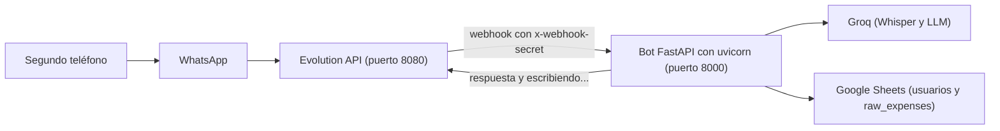

# 💻 Instructivo: levantar el proyecto punta a punta en entorno local

Guía paso a paso para correr el **bot directamente en tu máquina** (Python + uvicorn, con recarga automática y debugger) y conectarlo a **Evolution API**, el WhatsApp del bot. Para Evolution tenés dos opciones: en Docker (la más simple) o nativo, sin Docker. Si preferís todo en contenedores, usá el [instructivo Docker](instructivo_docker.md).



> **¿Dónde se guardan mis datos? En Google Sheets.** Los gastos (`raw_expenses`) y los usuarios (`usuarios`) viven solo en tu spreadsheet; el bot **no necesita PostgreSQL**, ni siquiera para correr en local. El único PostgreSQL de esta guía es la **base interna de Evolution API** (la exige para guardar la sesión de WhatsApp y los mensajes que recibe; guarda una copia de ellos, aparte de tu hoja). Si no querés instalarlo en tu máquina, la **opción A** lo deja encerrado en el contenedor de Evolution.

## Elegí cómo correr Evolution

| | **Opción A: Evolution en Docker** | **Opción B: Evolution nativo (sin Docker)** |
| :--- | :--- | :--- |
| Necesitás | Docker Desktop (Postgres y Redis van dentro del contenedor) | Node.js 20+ (probado con 24), `git` y PostgreSQL instalado en tu máquina |
| Redis | Incluido en el compose | No hace falta (caché local) |
| `EVOLUTION_API_URL` en el `.env` del bot | `http://localhost:8080` | `http://localhost:8080` |
| `--url` del webhook (Paso 4) | `http://host.docker.internal:8000/api/v1/webhooks/evolution` | `http://localhost:8000/api/v1/webhooks/evolution` |
| Dónde escucha uvicorn (Paso 1) | `--host 0.0.0.0` | `--host 127.0.0.1` |

> En la opción A, Evolution corre dentro de un contenedor y llega al bot que está en tu máquina a través de `host.docker.internal` (por eso uvicorn escucha en `0.0.0.0`). En la B todo vive en tu máquina y alcanza con `localhost`.

## Requisitos

- **Python 3.11+** y las dependencias del proyecto (el repo suele traer un `venv/` ya armado).
- Una **API key de Groq** y la **cuenta de servicio de Google** (el `.json` en `config/credentials/`).
- **Un segundo teléfono**: el bot "es" el WhatsApp que vinculás por QR, y los mensajes que te mandás desde ese mismo número se ignoran a propósito. Conviene vincular un número dedicado al bot: Evolution usa una conexión no oficial de WhatsApp.
- Según la opción de Evolution: Docker Desktop (A), o Node.js + PostgreSQL + `git` (B).

## ✅ Qué tenés que completar antes de empezar

1. **Rotá la `GROQ_API_KEY`** si alguna vez estuvo en un commit (aunque hayas limpiado el historial, dala por comprometida) y pegá la nueva en tu `.env`.
2. **Completá tu `.env`.** Si ya tenés uno, agregale estas variables (no hagas `cp .env.example .env`, que lo pisa):

   | Variable | Valor en entorno local | De dónde sale |
   | :--- | :--- | :--- |
   | `EVOLUTION_API_URL` | `http://localhost:8080` | Donde escucha Evolution (opciones A y B). |
   | `EVOLUTION_API_KEY` | la `AUTHENTICATION_API_KEY` del Paso 2 | La definís vos al configurar Evolution. |
   | `EVOLUTION_INSTANCE` | `bot-wpp` | El nombre que le des a la instancia en el Paso 3. |
   | `EVOLUTION_WEBHOOK_SECRET` | una clave larga aleatoria | `python3 -c "import secrets; print(secrets.token_urlsafe(32))"` |

   Opcionales: `SHEETS_WEBHOOK_SECRET` (aprobaciones en tiempo real, requiere una URL pública: ver [apps_script_usuarios.md](apps_script_usuarios.md)), `REPORTS_FOLDER_ID` y `REPORT_COOLDOWN_SECONDS`.

   El resto (`GROQ_API_KEY`, `GOOGLE_SHEETS_SHEET_ID` o `SPREADSHEET_ID`, `GOOGLE_SHEETS_TAB_NAME` o `WORKSHEET_NAME`) ya debería estar. Las variables viejas `N8N_*`, `WEBHOOK_URL` y `WHATSAPP_*` no se usan más: podés borrarlas (y revocar el token de Meta).

   > Los valores del `.env` son para correr en tu máquina. Si más adelante corrés el bot en Docker, `EVOLUTION_API_URL` pasa a ser `http://host.docker.internal:8080`.
3. **Google Sheets.**
   - Compartí la hoja (rol **Editor**) con el `client_email` de la cuenta de servicio: `grep client_email config/credentials/*.json`.
   - Creá la pestaña **`usuarios`** con los encabezados de [sheets_schema.md](sheets_schema.md#pestaña-usuarios-control-de-acceso). En macOS podés copiarlos y pegarlos en `A1`:
     ```bash
     printf 'Telefono\tNombre\tEmail\tEstado\tFecha_Registro\n' | pbcopy
     ```
     Si la pestaña no existe, el bot no puede verificar a nadie y rechaza todos los mensajes.
   - La pestaña de gastos (`raw_expenses` por defecto) tiene que existir. Si está vacía, el bot crea sus 10 encabezados; si ya tiene otra estructura (por ejemplo la de la versión anterior), **reemplazala** por la de [sheets_schema.md](sheets_schema.md#pestaña-raw_expenses-registro-de-gastos), porque si falta alguna columna el bot se niega a guardar. En macOS:
     ```bash
     printf 'timestamp\tmessage_id\tuser_phone_hash\tfecha_gasto\tmonto\tmoneda\tcategoria\tsubcategoria\tmedio_de_pago\tdescripcion\n' | pbcopy
     ```
   - Para los **reportes** habilitá la **Google Drive API** en el proyecto de GCP de la cuenta de servicio (y, opcionalmente, `REPORTS_FOLDER_ID` en el `.env`).

## 🚀 Paso a paso

Conviene tener **tres terminales**: una para Evolution, una para el bot y una para los comandos sueltos.

### 1. Preparar el bot

En la carpeta del repo:

```bash
python3 -m venv venv                       # solo si todavía no existe
venv/bin/pip install -r requirements.txt
venv/bin/pytest -q                         # opcional: los tests no necesitan red ni credenciales
```

Todavía **no lo arranques**: primero va Evolution. Cuando llegue el momento (Paso 3), usá el comando de tu opción:

```bash
# Opción A (Evolution en Docker)
venv/bin/uvicorn src.main:app --host 0.0.0.0 --port 8000 --reload
# Opción B (Evolution nativo)
venv/bin/uvicorn src.main:app --host 127.0.0.1 --port 8000 --reload
```

### 2. Levantar Evolution API

#### Opción A: en Docker

Seguí el **Paso 1 del [instructivo Docker](instructivo_docker.md#1-levantar-evolution-api)** (carpeta `~/evolution`, `docker-compose.yml`, `.env` con claves aleatorias y `docker compose up -d --wait`). Es idéntico: Evolution queda en `http://localhost:8080`.

#### Opción B: nativo, sin Docker

1. **PostgreSQL (solo para Evolution, no para el bot).** Con Homebrew:
   ```bash
   brew install postgresql@14            # si todavía no lo tenés
   postgres --version                    # si falla con "Library not loaded: ... libicu...", corré: brew reinstall postgresql@14
   brew services start postgresql@14
   psql postgres -c "CREATE USER evolution WITH PASSWORD '<clave-db>';"
   psql postgres -c "CREATE DATABASE evolution OWNER evolution;"
   ```
   Para `<clave-db>` usá una clave aleatoria sin caracteres especiales (`python3 -c "import secrets; print(secrets.token_urlsafe(16))"`).

   > Redis no es necesario: abajo se desactiva y Evolution usa caché local.

2. **Descargar e instalar Evolution** (versión fija 2.3.7). Hacelo en una carpeta **fuera del repo**, por ejemplo `~/evolution`:
   ```bash
   git clone --depth 1 --branch 2.3.7 https://github.com/EvolutionAPI/evolution-api.git ~/evolution
   cd ~/evolution
   npm install --ignore-scripts
   ```
   `--ignore-scripts` evita que las dependencias ejecuten scripts de instalación; no hace falta ninguno.

3. **Configurarlo.** Creá `~/evolution/.env` con este contenido mínimo (reemplazá los `<...>`):
   ```
   SERVER_PORT=8080
   SERVER_URL=http://localhost:8080
   AUTHENTICATION_API_KEY=<clave-global>
   DATABASE_PROVIDER=postgresql
   DATABASE_CONNECTION_URI=postgresql://evolution:<clave-db>@localhost:5432/evolution?schema=public
   DATABASE_SAVE_DATA_INSTANCE=true
   DATABASE_SAVE_DATA_NEW_MESSAGE=true
   DATABASE_SAVE_MESSAGE_UPDATE=true
   DATABASE_SAVE_DATA_CONTACTS=true
   DATABASE_SAVE_DATA_CHATS=true
   CACHE_REDIS_ENABLED=false
   CACHE_LOCAL_ENABLED=true
   ```
   Generá `<clave-global>` con `python3 -c "import secrets; print(secrets.token_urlsafe(32))"`: es el valor que va en `EVOLUTION_API_KEY` del `.env` del bot. No uses el archivo `env.example` que trae el repo: tiene una clave de ejemplo conocida y Redis activado.

4. **Preparar la base, compilar y arrancar:**
   ```bash
   npm run db:generate
   npm run db:deploy      # aplica las migraciones
   npm run build
   npm run start:prod     # dejá esta terminal abierta
   ```
   Desde otra terminal: `curl -s localhost:8080/` debe responder `"Welcome to the Evolution API, it is working!"` con `"version":"2.3.7"`.

> **Versiones:** usá `2.3.7` (el último estable). Según la documentación oficial de Evolution, desde la 2.4.0 cada instancia debe activarse contra su servidor de licencias antes de responder (no lo probé).

### 3. Vincular el WhatsApp del bot y arrancar el bot

Con Evolution corriendo y desde su carpeta (`~/evolution`, donde está el `.env` con `AUTHENTICATION_API_KEY`):

```bash
KEY=$(grep '^AUTHENTICATION_API_KEY=' .env | cut -d= -f2)
curl -s -X POST localhost:8080/instance/create -H "apikey: $KEY" -H 'Content-Type: application/json' \
  -d '{"instanceName":"bot-wpp","integration":"WHATSAPP-BAILEYS","qrcode":true}' >/dev/null
curl -s localhost:8080/instance/connect/bot-wpp -H "apikey: $KEY" \
  | python3 -c "import sys,json,base64; open('qr.png','wb').write(base64.b64decode(json.load(sys.stdin)['base64'].split(',',1)[1]))" && open qr.png
```

Escaneá el QR desde el teléfono del bot: **WhatsApp → Dispositivos vinculados → Vincular un dispositivo**. Vence rápido: si pasa, repetí solo el segundo `curl`. Confirmá con `curl -s localhost:8080/instance/connectionState/bot-wpp -H "apikey: $KEY"` (tiene que decir `"state":"open"`). Alternativa visual: `http://localhost:8080/manager`.

Ahora sí, en la terminal del bot (carpeta del repo) arrancalo con el comando de tu opción del Paso 1 y verificá:

```bash
curl -s localhost:8000/api/v1/health     # {"status":"ok",...}
```

### 4. Conectar Evolution con el bot

En la carpeta del repo, con el bot corriendo:

```bash
# Opción A (Evolution en Docker)
venv/bin/python scripts/setup_evolution_webhook.py --url http://host.docker.internal:8000/api/v1/webhooks/evolution
# Opción B (Evolution nativo)
venv/bin/python scripts/setup_evolution_webhook.py --url http://localhost:8000/api/v1/webhooks/evolution
```

El script usa `EVOLUTION_API_URL`, `EVOLUTION_API_KEY`, `EVOLUTION_INSTANCE` y `EVOLUTION_WEBHOOK_SECRET` de tu `.env` y configura la instancia para enviar cada mensaje nuevo (`MESSAGES_UPSERT`, con el audio inline) al bot, con el secreto en el header `x-webhook-secret`. Tiene que terminar con `✅ Webhook configurado` y `events: ['MESSAGES_UPSERT']`.

### 5. Probar de punta a punta

Mirá la terminal del bot y, **desde el segundo teléfono**, escribile al número del bot:

1. **`hola`** → el bot te pide nombre y apellido, después el email, y cierra avisando que la cuenta **requiere aprobación manual del administrador**.
2. En la pestaña `usuarios` aparece tu fila con `estado` vacío. Cargá **`1`** (aprobado).
3. Esperá hasta **60 segundos** (el bot cachea la lista de usuarios) y mandá *"Gasté 15 USD en almuerzo con débito"* → responde "✅ Gasto Registrado con Éxito" y aparece una fila en `raw_expenses`.
4. Mandá una **nota de voz** con un gasto: se transcribe con Whisper y se registra igual.
5. Cambiá `estado` a **`2`** (rechazado), esperá la caché y escribí de nuevo → responde "⛔ Acceso denegado".

6. Pedí tu **reporte** escribiendo *"quiero mi resumen"* (o por audio): el bot responde con el link a un Google Spreadsheet con **solo tus gastos**, compartido en solo lectura con el email que dejaste en el onboarding. Hay un enfriamiento de 5 minutos entre reportes.

Mientras Groq procesa, el chat muestra "escribiendo…".

## 🔧 Operación diaria

| Qué querés hacer | Cómo |
| :--- | :--- |
| Detener el bot | `Ctrl+C` en su terminal |
| Detener Evolution | Opción A: `docker compose down` en `~/evolution`. Opción B: `Ctrl+C` en su terminal. |
| Detener PostgreSQL (opción B) | `brew services stop postgresql@14` |
| Cambiaste el `.env` del bot | Reiniciá uvicorn: el `.env` se lee solo al arrancar |
| Dejar Evolution en segundo plano (opción B) | `nohup npm run start:prod > evolution.log 2>&1 &` |
| Reiniciar la sesión de WhatsApp | Volvé a hacer el Paso 3 (borrar la instancia con `curl -X DELETE localhost:8080/instance/delete/bot-wpp -H "apikey: $KEY"` y crearla de nuevo) |

## 🩺 Si algo falla

| Síntoma | Causa probable | Qué hacer |
| :--- | :--- | :--- |
| El webhook responde **503** (log: `EVOLUTION_WEBHOOK_SECRET is not configured`) | Falta la variable, o no reiniciaste uvicorn | Completala en el `.env` y reiniciá el bot |
| **401** `Invalid webhook secret` | El secreto del `.env` no coincide con el guardado en Evolution | Repetí el Paso 4 |
| Evolution no llega al bot (opción A) | uvicorn escucha en `127.0.0.1` | Arrancalo con `--host 0.0.0.0` y usá `host.docker.internal` en `--url` |
| `host.docker.internal` no resuelve al correr un comando | Ese nombre solo existe dentro de los contenedores | En comandos de tu terminal usá `localhost`; `host.docker.internal` solo va en `--url` |
| El bot procesa pero no contesta (log: `Failed to send WhatsApp message`) | `EVOLUTION_API_URL`, `EVOLUTION_API_KEY` o `EVOLUTION_INSTANCE` mal, o la instancia no está `open` | Revisalos y consultá `connectionState` |
| Responde "No pudimos verificar tu acceso" | Falta la pestaña `usuarios`, los encabezados están mal, o la hoja no está compartida con la cuenta de servicio | Mirá el log del bot (`Users worksheet ... not found`) |
| `postgres` falla con `Library not loaded: ... libicu...` | Homebrew actualizó `icu4c` y dejó roto PostgreSQL | `brew reinstall postgresql@14` |
| `npm run db:deploy` no conecta | PostgreSQL apagado, usuario o clave distintos a los del `.env` de Evolution | `brew services start postgresql@14` y revisá `DATABASE_CONNECTION_URI` |
| `EADDRINUSE` / puerto ocupado | 8080 u 8000 en uso | Cerrá lo que los use (`lsof -nP -iTCP:8080 -sTCP:LISTEN`) o cambiá `SERVER_PORT` en Evolution |
| No responde a tus mensajes | Le estás escribiendo desde el mismo número vinculado | Usá otro teléfono |
| Falla un audio de iPhone | Bug conocido de Evolution al descargar medios de iOS | Probá con texto o con un audio desde Android |

## 🔬 Qué está verificado

Probado en macOS con Python 3.12, Node 24 y Evolution API 2.3.7:

- **Bot:** instalación de dependencias, arranque con uvicorn (con `.env` real) y que las variables de entorno tienen prioridad sobre el `.env`.
- **Opción A:** configuración del webhook y entrega de eventos desde Evolution en Docker hacia un servicio que escucha en tu máquina vía `host.docker.internal`.
- **Opción B (nativo, sin Docker ni Redis):** `npm install --ignore-scripts`, `db:generate`, `db:deploy` con un usuario de base sin privilegios de superusuario (con el mismo SQL de arriba), `build`, `start:prod`, API y Manager respondiendo, generación del QR, y entrega autenticada de webhooks (HTTP 200) al bot real en `127.0.0.1:8000`. El script `setup_evolution_webhook.py` configuró correctamente `MESSAGES_UPSERT`.

No verificado: los comandos `brew` de PostgreSQL (la base de pruebas fue un PostgreSQL 15 temporal con el mismo SQL), el escaneo del QR y los mensajes reales de WhatsApp (texto y audio), tu Google Sheet real y las llamadas a Groq.
